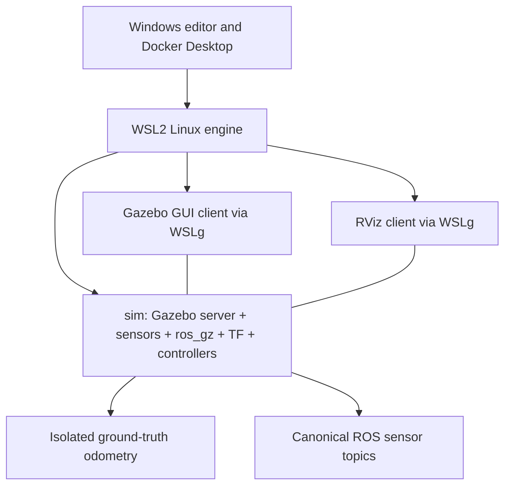

# Current system state

Snapshot date: 2026-10-14 (America/Los_Angeles). Implementation revision inspected: `3e9d702`.

## Status

The project has an executable legacy simulator baseline, sensor delivery checks, command-expiry checks, and WSLg GUI launch support. It is not yet a measured GEM e6 digital twin or a validated SLAM platform.

At the inspection, `agile-slam-sim-1` was running and the GUI clients had exited. The user subsequently confirmed that the GUI windows were closed manually. The observed exit codes alone are not evidence of an unsolicited runtime failure. Sustained GUI performance has not been benchmarked.

## Environment and deployment

| Layer | Current configuration |
|---|---|
| Host | Windows 11; repository at `D:\UCSD\Lectures\AVL\Agile_SLAM` |
| Linux runtime | WSL2 Ubuntu-22.04 and Docker Desktop Linux engine |
| Audited versions | Docker Desktop 4.76.0; Engine 29.5.2; WSL kernel 6.6.114.1 |
| Base image | `agile_control_ros2:baseline-20261014`; pinned local image ID in README |
| Runtime image | `agile_slam:humble-baseline`; Ubuntu 22.04 / ROS 2 Humble / Gazebo Fortress |
| Rendering | Mesa software rendering; Xvfb for server-side sensors; WSLg X11 for GUI clients |
| ROS middleware | CycloneDDS; `ROS_DOMAIN_ID=42`; loopback interface; 65,500-byte max message; 4,000-byte fragments |
| ROS time | Gazebo `/clock`; simulation nodes use simulation time |
| Build | One colcon build during image creation; three active source packages |
| Storage | Source copied into `/opt/agile_slam_ws`; only local `artifacts/` mounted writable |
| Hardware access | No CAN/USB passthrough, no privileged mode, no real-vehicle driver launched |

The supplied image includes FAST-LIO, PACMod2, Nav2, and RViz. Only RViz is used by the GUI launcher; FAST-LIO, PACMod2, and Nav2 are not currently launched. NVIDIA/CUDA/GPU rendering have not been validated.

The GUI clients are separate containers but reuse the simulator's network namespace. This is not the planned independent-container DDS acceptance test. The clients use the same runtime image, ROS domain, and Gazebo partition. Recreate clients after recreating the server.

## Repository and source packages

- Public repository: https://github.com/linarthurlin/agile_slam
- `gem_description`: imported Xacro, meshes, and description resources.
- `gem_gazebo`: adapted simulator controller, bridge configuration, and baseline world.
- `avl_bringup`: startup orchestration and integration checks.
- `containers/`, `config/`, `scripts/`: environment and operational tools.
- `third_party/`: source SHA256 manifest and retained license notices.
- `docs/plans/`: Traditional Chinese implementation plans; other project documentation is English.
- GitHub Actions validates parsing and four regression tests. It does not build the private local base image or validate GPU/CAN hardware.

## Vehicle configuration

These are inherited simulation values, not measured e6 specifications. Positions are expressed relative to the current `base_link` with zero wheel joint positions.

| Parameter | Current value |
|---|---|
| Vehicle representation | e2-derived GEM surrogate |
| Front axle x | +0.88 m |
| Rear axle x | -0.87 m |
| Wheelbase | 1.75 m, obtained from TF |
| Track | 1.20 m |
| Wheel radius / diameter | 0.295 m / 0.59 m |
| Tire width property | 0.16 m |
| Steering joint limits in URDF | +/-0.61 rad, approximately +/-35 degrees |
| Steering joint velocity limit in URDF | 0.5 rad/s |
| Base link mass | 686 kg |
| Sum of expanded URDF link masses | Approximately 734.832 kg; not a calibrated physical mass |
| `base_link` relative to `base_footprint` | Translation [0, 0, 0.44] m |
| Control input | `/ackermann_cmd`, `ackermann_msgs/msg/AckermannDrive` |
| Controller update | 30 Hz |
| Command expiry | 0.5 s of simulation time |
| Actuation | Two steering position controllers and four wheel velocity controllers |
| State publication | One joint-state broadcaster, giving seven controllers total |

The current base origin is near the axle midpoint, not the rear-axle origin proposed for the future e6 model. Steering joint limits are declared model limits; this does not prove the high-level command is bounded or that the real actuator follows those rates. The current velocity-control path is not a throttle/brake/steering PACMod plant.

## World

`baseline.sdf` defines a 100 x 100 m plane, a 0.3 x 12 x 4 m wall at [8, 0, 2] m, gravity [0, 0, -9.81] m/s2, a 1 ms physics step, and a configured real-time factor of 1. The achieved real-time factor has not passed a sustained performance test. No online track assets are required.

## Sensors

Rates below are configured rates, not measured acceptance results.

| Sensor | Current model | Nominal configuration | Integration status |
|---|---|---|---|
| Main LiDAR | GPU lidar, VLP16-like surrogate | 10 Hz; 16 x 1,875 samples; 360-degree horizontal / 30-degree vertical FOV; 1-100 m range; zero configured range noise | ROS cloud delivery passed; not a verified hardware model |
| Main IMU | Gazebo IMU | 50 Hz; legacy noise block is present but its effective noise model is unvalidated | ROS delivery, frame, and stationary gravity sanity passed |
| Front RGB camera | One camera on `stereo_camera_link` | 800 x 600; 30 Hz; approximately 80-degree horizontal FOV; 0.02-300 m clip | ROS image and CameraInfo delivery passed |
| Depth camera | Generic depth camera on the same mount | 800 x 600; 30 Hz; approximately 60-degree horizontal FOV; 0.1-300 m clip | Gazebo topics observed; not bridged or validated as a ROS/RealSense stream |
| GNSS | Gazebo NavSat | 20 Hz | Gazebo topic observed; not bridged into the baseline ROS graph |
| Front LiDAR x3 | Not implemented | Hardware models and 2D/3D type unconfirmed | Pending |
| Additional cameras | Not implemented | Actual inventory unconfirmed | Pending |
| RealSense-specific streams/model | Not implemented | Serial/model, IR, alignment, depth scale, and optional IMU unconfirmed | Pending |

The legacy `front_single_camera_sensor` 640 x 480 declaration references a link absent from the expanded robot. It is not the active front camera and must not be counted as an integrated second camera. The `stereo_camera_link` name also does not establish an actual stereo pair.

Current mounts, composed from the expanded URDF:

| Frame | Translation from `base_link` [x,y,z], m | Approximate orientation |
|---|---|---|
| `velodyne_link` | [-0.12172, 0, 1.54210] | Identity, apart from source rounding |
| `IMU_link` | [-0.246, 0, 0.05] | Yaw -90 degrees |
| `stereo_camera_link` | [0.394, 0, 1.19] | Identity |
| `camera_front_optical_frame` | Same camera position | Optical-axis convention via fixed joint |
| `GPS_link` | [-0.246, 0, 0.05] | Identity |

These mounts are model inputs, not calibration results. In particular, IMU axes differ from vehicle axes and must be handled explicitly in a future LIO adapter.

## ROS interfaces and TF

| ROS topic | Type / purpose |
|---|---|
| `/clock` | Clock from Gazebo |
| `/sensors/velodyne/points` | PointCloud2; x/y/z/intensity/ring, 30,000 points per configured cloud |
| `/sensors/imu/data_raw` | Imu, frame `IMU_link` |
| `/sensors/cameras/front/image_raw` | Image, frame `camera_front_optical_frame` |
| `/sensors/cameras/front/camera_info` | CameraInfo, same optical frame |
| `/joint_states` | JointState feedback from simulated controllers |
| `/ground_truth/odometry` | Odometry for evaluation only, parent frame `world` |
| `/ackermann_cmd` | Direct simulator drive command |
| `/tf`, `/tf_static` | Robot description and joint-derived transforms |

There is no operational `map -> odom -> base_link` estimator chain yet. No `/odom` or `/odometry/local` publisher was present during the baseline check. Robot state transforms form the vehicle/sensor tree rooted at `base_footprint`; truth odometry does not publish an operational TF edge. RViz uses `base_link` as a local fixed frame.

The LiDAR cloud has no per-point time. Do not claim deskew accuracy or synthesize firing times from a snapshot without a physically consistent rolling-scan model. Large-message best-effort loss was observed; reliable image/cloud subscriptions passed the short checks. Rates, latency, recorder completeness, and long-duration robustness remain unvalidated.

## Verified and pending work

Passed: clean three-package build, model spawn, seven controllers, seven required ROS streams, basic IMU/frame sanity, vehicle motion, command-expiry zero wheel commands, source/XML checks, and four regression tests. Gazebo/RViz windows were created and the client discovered the existing world. The user confirmed the subsequent GUI shutdown was manual; it is not tracked as an unexplained GUI failure. Sustained GUI performance remains unmeasured.

Ordered backlog:

1. [Transport and record/replay](https://github.com/linarthurlin/agile_slam/issues/1): sustained rate/loss/latency/RTF, recording QoS, manifests, static-TF late join, pause/reset, and eventual independent-container transport.
2. [FAST-LIO contracts](https://github.com/linarthurlin/agile_slam/issues/2): source revision, suitable reference dataset, point-time schema, IMU/extrinsic conventions, TF ownership, and snapshot versus rolling-scan modes.
3. [e6/full sensors/PACMod](https://github.com/linarthurlin/agile_slam/issues/3): measured vehicle inventory/geometry, three front lidars, real camera inventory, RealSense contracts, DBW mock, and confirmed real board/firmware/DBC.
4. Calibration lab: truth versus nominal separation, targets, spatial/time calibration tools, versioned results, and held-out validation.
5. Evaluation: reproducible routes, ATE/RPE/failure metrics, loop closure, degradation sweeps, and compute/load tests.
6. Deployment: GPU/GUI stability, supported ROS/Gazebo migration, native-Linux hardware drivers, read-only real data, and controlled low-speed real-vehicle validation.

## Operating commands

Start the server: `docker compose up -d`.

Open GUI clients from WSL at the repository root: `bash scripts/gui.sh`.

Stop GUI clients: `docker stop agile-slam-gazebo agile-slam-rviz`.

Stop the server: `docker compose down`.

Source changes require `docker compose build` and server recreation. Stop GUI clients before server recreation. Full instructions are in `docs/setup.md`.
