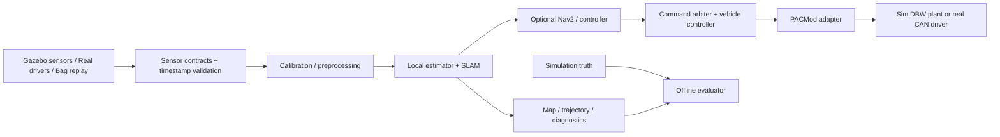

# GEM e6 全車模擬、感測器整合、校正與 SLAM Implementation Plan

日期：2026-10-14。狀態：設計提案，尚未執行移植、建置或實車驗證。


> 2026-10-14 修訂：專案更名 Agile_SLAM。已核對既有 agile_control_ros2 image，內含 Humble、FAST-LIO、PACMod2，但未找到 Gazebo；優先復用它建立 derived image，初期單一 container，再依 DDS 驗收拆分。環境與部署決策以 [Docker／WSL2 修訂](docker_wsl_deployment.md) 為準。

## 1. 決策摘要

將 `D:\UCSD\Lectures\AVL\golf_cart_sim-main` 的可用資產移植至 `D:\UCSD\Lectures\AVL\Agile_SLAM`，建立研究平台，而不是將現有 simulator 原封不動改名。保留來源快照與授權，另外建構 e6 車輛描述、感測器模型、ROS 2 contracts、PACMod adapter、校正工具及評測管線。

建議採用兩階段環境：先在 Ubuntu 22.04／ROS 2 Humble／Fortress 的隔離環境重現來源，固定可工作的 baseline；主平台目標為 Ubuntu 24.04／ROS 2 Jazzy／Gazebo Harmonic，須以實車 driver、SDK、PACMod message package 的 compatibility spike 通過為升級條件。官方搭配是 Humble–Fortress、Jazzy–Harmonic；不能把 Dockerfile 的發行版字串替換視為完成移植。[Gazebo ROS 安裝矩陣](https://gazebosim.org/docs/harmonic/ros_installation/)

以目前日期，Fortress 已超過官方列出的 2026 年 9 月支援終點，因此只作重現用的過渡環境；不要將新平台長期綁在它上面。Harmonic 的支援期限較長；實作時再次核對依賴與發布政策。[Gazebo release lifecycle](https://gazebosim.org/docs/latest/releases/)

平台須支援三種 backend：`sim`、`replay`、`real`。上層感測器處理與 SLAM 保持相同介面，backend 差異集中在 bringup、driver、車輛 I/O 與時間來源。先完成感測器可信度與可重播能力，再建立 Velodyne＋主要 IMU 的 SLAM 基線；camera／RealSense／前方三顆 LiDAR 逐步加入比較，不以全部融合為第一個里程碑。

## 2. 已核對的輸入與限制

已讀引用 chat「規劃 GEM e6 感測器整合」，需求包含 cameras、Velodyne LiDAR、3× front LiDAR、RealSense、GPU、IMU，以及 GEM e6 的 PACMod drive-by-wire。尚無確定型號、數量完整清單、序號、安裝位置或 PACMod firmware／DBC。因此下文 sensor rates、誤差與效能指標都是設計初值，不是實車規格。

Agile_SLAM 在本次檢查時沒有現有程式。未找到 AVL 子樹的 AGENTS.md。來源 README 標示 GEM e2、Humble、Fortress；LEAD-Flow README 自述是 scaffold，`docs/REVIEW.md` 仍將 PACMod 世代、車身參數與實車 topic 列為待確認，不能作為已驗證部署參考。

| 來源資產／發現 | 對移植的影響與處置 |
|---|---|
| `gem_description/urdf/gem.urdf.xacro`、meshes | 可重用視覺與結構；e2 標籤與 e6 實際幾何不一致，需量測 wheelbase、track、輪徑、碰撞輪廓、重心、慣量與 mounts |
| LiDAR：16 vertical samples、1875 horizontal samples、10 Hz、±15°、1–100 m、零 range noise | 是 VLP16-like 理想模型；不能推論實車就是 VLP16，亦未證明逐點 firing time、ring、intensity 與真實掃描運動 |
| `gem.gazebo`：camera 640×480／30 Hz、IMU 50 Hz、NavSat 20 Hz | camera／IMU 可作 bringup 起點；非全部硬體清單，IMU noise XML 需依選定 SDF 版本驗證 |
| `gz_bridge.yaml` | `/odom` 重複設定；camera_info topic 與 sensor 宣告不同；逐一核對實際 Gazebo topic、message mapping 與 frame |
| Xacro 使用 ignition odometry plugin，但 control 使用 `gz_ros2_control/GazeboSimSystem` | 版本／shared library 名稱可能混搭，先查安裝產物與 plugin loading log，不能預先保證 Humble 能跑 |
| `/odom` 由 Gazebo OdometryPublisher 輸出，`odom_to_tf.py` 直接發布 TF | 重新路由至 ground-truth namespace；SLAM 評測禁止把它當 wheel odom 或 estimator pose |
| `gem_control.py` 在 update() 末尾刷新 `last_cmd_time` | command age 會被每輪更新重設，0.5 s timeout 可能失效；拆成 last_received_command 與 last_update，補失聯測試 |
| `get_link_position()` 的 lookup_transform(link, reference_frame) | 與所需「link 在 reference 中位置」方向疑似相反；需用已知 transforms 驗證，改用設定值提供車身幾何，避免靜默 fallback 1.75 m |
| Compose 三個 service 共用 workspace 並各自 colcon build | 會競爭 build/install/log；改成單次 build、唯讀 install、各程序獨立 log 與有條件啟動 |
| Compose：privileged、整個 /dev、Linux X11、NVIDIA runtime、host network | 不是可攜的 Windows 設定；分開 WSL／Linux GUI／headless／real-device profiles |
| `gem_0025_real/.../cmd_vel_to_pacmod2.py` | 具有 steering／accel／brake／shift pubs 與 50 Hz loop，可作語意參考；不代表實車 PACMod 版本已確認 |
| 原 Nav2 global frame 為 odom | 適合局部 demo，需區分 mapping、localization 與 navigation 模式；加入 SLAM 後指定 map authority |

以上為靜態檔案觀察；尚未執行 ROS graph、Gazebo、Docker build 或 GPU benchmark。

## 3. 系統架構與模組邊界



分成六層：environment、vehicle/sensors、interface、calibration、estimation、evaluation。導航與 LEAD-Flow 是可插拔 consumer，不讓它們反過來決定基礎感測器架構。Python 核心工具與 ROS runtime 分開，參考 LEAD-Flow 的 offline／ROS 雙層設計；不移植其未驗證的 learning controller。

### 3.1 目標 repository layout

```text
Agile_SLAM/
  README.md
  docs/
    implementation_plan.md
    architecture/             # TF、topics、time、ADR、sim fidelity
    setup/                    # WSL/Linux/container/real bringup
    procedures/               # calibration、record/replay、validation
  third_party/golf_cart_sim/   # 原始快照、LICENSE、SOURCE.yaml、checksums
  containers/                 # baseline、jazzy、headless、GPU variants
  scripts/                    # doctor、build、launch、record、evaluate
  config/
    vehicles/gem_e6.yaml
    sensors/inventory.yaml
    profiles/                 # minimal、full、calibration、stress
    interfaces/               # topics、QoS、PACMod generation
    scenarios/                # world、route、seed、faults、metrics
  calibration/<id>/           # manifest、intrinsics、extrinsics、time、validation
  avl_tools/                  # ROS-independent manifests、metrics、reporting
  ros2_ws/src/
    avl_description/          # parameterized vehicle + sensor Xacro
    avl_simulation/           # Gazebo worlds、plugins、bridge、sensor adapters
    avl_sensor_bringup/       # hardware driver launch and remapping
    avl_interfaces/           # only genuinely shared custom messages
    avl_vehicle_interface/    # arbitration、controller、PACMod backends
    avl_calibration/          # dataset capture、exports、validation nodes
    avl_localization/         # odometry/SLAM integrations and TF adapters
    avl_bringup/              # sim/replay/real top-level launch
    avl_diagnostics/          # rates、age、TF、clock、resource checks
  tests/                      # contracts、launch integration、scenario regression
  datasets/index/             # checksums and locations; no large bags in Git
  results/                    # versioned report index; bulky output external
```

`third_party` 不可被 colcon 同時發現；加 COLCON_IGNORE，移植的 package 必須只有一份 active implementation。每個 package 有 package.xml、安裝規則、config、launch 與 README。來源無 `.git` 歷史時以快照 hash 記錄 provenance，不虛構 upstream commit。優先維持原 package 名稱於 baseline；主平台才逐模組轉為 avl_*，避免同時改名與 debug。

### 3.2 移植策略

1. 先建立來源檔案清單、SHA256、授權清單與來源 URL；來源資料夾保留不動。
2. vendored snapshot 排除 build/install/log/cache；保留 meshes、worlds、config 與 licenses。確認第三方 track／mesh 再散布權利。
3. baseline 只修 build blockers、plugin compatibility、topic、clock 與 timeout；每項修正有 patch ledger。
4. 主 workspace 只放被選用的 ROS packages；將巢狀 `gem_0025_real/.../src` 整理為正常 package 層級，先以 mock adapter 避免未知 driver 擋住模擬。
5. 每次搬一個模組，通過相應 gate，再進下一步；保存 baseline image digest、依賴版本與 gold bag。
6. rollback 使用原始快照及已驗證 image／config，不刪除來源或覆蓋實車 calibration。

## 4. 環境建置

Windows 作編輯與檔案入口；ROS／Gazebo runtime 使用 WSL2 Ubuntu 或原生 Ubuntu。已發現 `wsl.exe`、`docker.exe`，但尚未驗證 distro、Docker daemon、GPU、WSLg、RAM、SSD 與顯示能力。

### 4.1 預設開發路線

Phase 0 先產出 doctor report：Windows／WSL 版本、distro、kernel、CPU、RAM、GPU／VRAM、driver、OpenGL renderer、磁碟空間、Docker daemon／context、DDS multicast、可用 ports。先做簡單 Gazebo rendering smoke test，再裝整車套件。

Linux build、install、log、bag 與模型 cache 放 WSL ext4／Docker named volume。專案指定的 D:\AVL 路徑作為 canonical source；`/mnt/d/...` 直接 build 可能有 I/O 負擔。若採 ext4 working mirror，僅以明確的單向 sync／Git 流程更新，禁止兩份 workspace 同時編輯。Microsoft 建議 Linux workload 的檔案保留在 Linux filesystem 以改善效能。[WSL filesystems](https://learn.microsoft.com/en-us/windows/wsl/filesystems)

第一個能跑的版本優先採單一 WSL distro 原生 ROS＋Gazebo，減少圖形轉接變數；可重現容器隨 baseline 一起完成。Linux CI 用 headless profile；實車端優先原生 Ubuntu，以便 CAN、NIC、USB 與硬體時間同步。

### 4.2 安裝與建置規約

- 用一個確定的 ROS/Gazebo 配對 image；禁止 apt wildcard `ros-humble-gz*`，列出必要依賴，以 rosdep 補 package dependencies。
- lock vcs repos commit、SDK、GTSAM、GPU dependencies、container digest；第一次可用後輸出 resolved version manifest。
- build stage 跑 colcon 一次，runtime source 固定 install；service 不在啟動時重編 workspace。
- profiles：`headless`、`gui-wsl`、`gui-linux`、`gpu`、`real`。CPU path 與 GPU path 分開驗證；GPU lidar 的 rendering 與 SLAM CUDA 運算各自量測。
- 同一 runtime profile 統一 RMW／DDS 設定；先單機／單容器，再驗證跨程序與跨主機 discovery。不要預設 Docker Desktop host networking 等同 Linux。
- sim 不需要 `/dev` 或 privileged；real 只傳必要裝置／CAN/network capabilities。各 run 固定 ROS_DOMAIN_ID，避免接到實車 command graph。
- 暫定建議開發機 8 cores／32 GB RAM／NVMe；全車影像與 GPU SLAM 依 benchmark 決定 VRAM、解析度與頻率，不承諾特定硬體即可達即時。

目標 CLI（尚未實作）：`scripts/doctor`、`scripts/build --profile jazzy`、`ros2 launch avl_bringup platform.launch.py backend:=sim sensor_profile:=minimal world:=calibration seed:=42`。每個命令必須有 preflight 與失敗原因；不能靠固定 sleep 等待 Gazebo 啟動，改用 spawn result、controller readiness 與 lifecycle 狀態。

## 5. GEM e6 全車模型

### 5.1 幾何、動力學與 fidelity

車身參數唯一來源 `vehicles/gem_e6.yaml`：wheelbase、front/rear track、輪胎 effective radius、轉向極限／速度、steering map、mass、CoM、inertia、collision envelope、離地高、感測器 mounts。每項值帶來源、量測日期、uncertainty、狀態 measured／manufacturer／placeholder。未量測可跑 sim placeholder，但 real profile 必須拒絕使用。

不要整體縮放 e2 mesh 充當 e6：visual mesh 可先沿用並標示 surrogate，collision、輪軸與 sensor placement 必須獨立參數化。第一階段只驗證低速 Ackermann；第二階段加入 actuator delay、rate limits、deadband、rolling resistance、grade、brake response、wheel slip；實車系統辨識後才聲稱有動態匹配。

保留兩種控制模式：`kinematic_debug` 直接速度／路輪角，適合感測器與幾何 debug；`dbw` 使用模擬油門／煞車／轉向系統與 reports，作整合驗收。後者至少具有一階／可辨識 plant 與飽和，不只是將油門重新命名成速度。

### 5.2 全感測器模型矩陣

| 裝置 | 初版模擬輸出 | 進階建模／必要驗證 |
|---|---|---|
| Velodyne | PointCloud2，真實型號未定前用現有 16-beam profile | 型號垂直角表、scan rate、range、ring、逐點時間、運動畸變、range noise、dropout；intensity 只作 surrogate |
| Front LiDAR ×3 | left/center/right 獨立 frame/topic；2D 用 LaserScan、3D 用 PointCloud2 | 各自 FOV、遮蔽、安裝角與 sync；尚未知 2D/3D，不能將三者都當 VLP16 |
| Cameras | 每顆 image_raw＋camera_info＋optical frame | 依 inventory 擴充 count；K/D/R/P、畸變模型、曝光、blur、rolling shutter 是否支援；不支援的效果交給明確 adapter |
| RealSense | RGB＋depth＋camera_info；需要時 stereo IR／內建 IMU | depth encoding、scale、aligned depth 的目標 frame、missing depth；原廠 wrapper interface 做 contract parity，不模擬 USB firmware |
| Main IMU | Imu raw，初值可設 200 Hz，依硬體修訂 | gyro/accel bias、white noise、random walk、gravity、軸向、saturation、clock offset/drift；不將 perfect orientation 洩漏成量測 |
| Wheel／steering feedback | wheel speed、measured steering、vehicle speed reports | quantization、delay、dropouts、noise 與 slip，作 noisy wheel odometry |
| GPU／compute | 不建立 sensor frame | CPU/GPU utilization、VRAM、溫度、pipeline latency、queue、RTF；延遲注入和真實運算負載都測 |
| GNSS（選配） | 原來源 navsat 可保留為 optional profile | 尚非確認實車清單，不讓 GNSS 成為 SLAM baseline 必要依賴 |

RealSense 實車支援與 frame/stream 配置以官方 wrapper 與 SDK 為準；模擬只承諾 ROS interface 和受控誤差模型。[RealSense ROS wrapper](https://github.com/realsenseai/realsense-ros)

### 5.3 LiDAR 時間模型是 SLAM gate

現有 GPU lidar 很可能輸出同一 pose 下的整張 snapshot；須實際檢查 PointCloud2 fields。可以從 scan lattice 建立 ring index，但不能把自行補上的逐點 time 說成真實 firing history。設兩個 profile：

- `snapshot`：所有點同一 acquisition time，關閉依賴真實 rolling scan 的 deskew，專測幾何與資料鏈。
- `rolling_scan`：子掃描在各自 t_i 渲染或 raycast，依實車 firing table 聚合；建立 point time、scan stamp、動態物件與車體姿態一致的量測。此模式通過轉彎／運動場景的真值誤差檢查後，才做 deskew 與 LIO accuracy 結論。

不將 Gazebo 點雲假裝成 Velodyne packets；若要驗證 packet decoder，以實車 PCAP／bag replay 建另一個 driver test。Velodyne ROS driver 是實車 driver 來源。[Velodyne ROS 2](https://github.com/ros-drivers/velodyne/blob/ros2/velodyne_driver/README.md)

## 6. ROS 2 contracts、TF 與時間

### 6.1 Topics 與語意

以下為平台 canonical names，vendor topics 由 adapters 映射；PACMod 原生名稱依版本保留於 backend。

| Topic | Type／語意 |
|---|---|
| `/sensors/velodyne/points` | PointCloud2；field schema 包含型別、單位、stamp 與 point-time 定義 |
| `/sensors/front_lidar/{left,center,right}/scan` 或 `/points` | LaserScan 或 PointCloud2；由型號決定 |
| `/sensors/cameras/<id>/image_raw`、`camera_info` | Image／CameraInfo，配對解析度與 optical frame |
| `/sensors/realsense/color/image_raw`、`depth/image_raw` | encoding 與 depth scale 固定寫入 contract |
| `/sensors/imu/data_raw` | Imu；gyro rad/s、accel m/s²，covariance 不得冒充完美資訊 |
| `/vehicle/command` | 暫用 AckermannDriveStamped，speed m/s、路輪角 rad；新增 acceleration contract 時另記 ADR |
| `/vehicle/state` | speed、路輪角、gear、enable、override、fault、timestamp；必要時專用 message |
| `/odometry/wheel`、`/odometry/local` | Odometry；前者是 feedback estimator、後者是 local estimator |
| `/slam/trajectory`、`/slam/map` | Path／點雲或演算法定義的 map，附匯出轉換 |
| `/ground_truth/*` | truth pose、twist、mounts、actuator state；僅 evaluator 可用 |
| `/diagnostics`、`/clock` | DiagnosticArray／Clock；clock 只有一個 authority |

Sensors QoS 起點 best-effort／volatile／bounded depth；需依實際 driver 改動並記錄。Command/state/diagnostics 採明確的 reliability、deadline、history；critical state change 不只依賴容易掉的 sensor profile。可靠傳輸也不能替代 command timestamp、expiry 與 watchdog。錄製端明確指定 QoS overrides，尤其 `/tf_static` 的 transient-local 行為。[ROS 2 QoS](https://docs.ros.org/en/jazzy/Concepts/Intermediate/About-Quality-of-Service-Settings.html)

### 6.2 TF ownership

```text
map -> odom -> base_link
                 ├── imu_link
                 ├── velodyne_link
                 ├── front_lidar_{left,center,right}_link
                 ├── camera_<id>_link -> camera_<id>_optical_frame
                 └── realsense_link -> vendor internal frames
```

base_link 定義為後軸中心的車體固定座標，並記錄高度；如保留 base_footprint，另定唯一父子關係。固定 sensor joints 由 robot_state_publisher；RealSense internal TF 與 wrapper 協調，只留一個發布者。odom→base_link 由選定 local estimator，map→odom 由 SLAM adapter。若 SLAM 只輸出 map→base，adapter 用時間對齊的 local odom 計算 map→odom。若演算法自己管理 local pose，停用競爭的 EKF TF。避免重複融合相同 IMU 所衍生且高度相關的 LIO pose 與 raw IMU。

ground truth 只發布 namespace 下的 pose／獨立 frames，不連接 operational TF；原先 world→odom identity 和 odom_to_tf 在 evaluation mode 移除。評測前檢查 estimator subscriptions 白名單，不只是依靠團隊記得不要訂閱真值。[REP-103](https://www.ros.org/reps/rep-0103.html)、[REP-105](https://www.ros.org/reps/rep-0105.html)

### 6.3 Clock 與可重播性

sim 的 `/clock` 由 Gazebo，replay 由 rosbag player；real 使用量測時鐘與硬體同步，不啟用 sim time。不可同時播放 bag clock 並橋接 Gazebo clock。所有 estimator、adapter、TF、recording nodes 在 sim/replay 統一 use_sim_time。

分離 acquisition timestamp、arrival time、publish time；保留 source timestamp 與人工注入的 clock error。延遲注入須延後 delivery，而非只改 header。offset、drift、jitter、dropout 的作用點與正負號寫入 scenario manifest。pause 時 sim-time control 停止推進；real watchdog 使用 steady clock；reset／向後跳時清空積分器、queue、TF buffer 與 estimator 狀態。

seed 與固定 physics step 提供可重現條件，但 GPU renderer／多執行緒最佳化不保證 bitwise deterministic；以容許誤差與多次統計驗證。

## 7. PACMod 與 vehicle interface

將高階 command arbiter、speed controller、PACMod conversion、DBW plant 分開。單一 command source 持有控制權，teleop／Nav2／研究 controller 不可同時直接寫 PACMod。speed/acceleration 與 throttle/brake 是不同物理量；必須以 feedback 與 plant/controller 連接。

sim backend：canonical command → controller → 原生 PACMod-like commands → simulated DBW（delay/deadband/rate/saturation）→ joints/forces → simulated reports → vehicle state。real backend：同一 controller/adapter → 已確認版本的 driver → CAN → PACMod reports。較早的 kinematic_debug bypass 必須在 run manifest 標示，不納入 DBW parity 驗收。

PACMod2 與 PACMod3 的 messages、enable/report semantics、topic、DBC 不可只靠 remap 互換。先實車 inventory，選擇一個受驗證 adapter，另一世代保持 optional。PACMod3 官方 driver 要求 DBC major version 與硬體相符。[PACMod3 ROS 2](https://github.com/astuff/pacmod3/tree/ros2_master)

狀態機：DISABLED → READY → ENABLED；override、fault、command expiry、missing reports 進入對應 disable/fault handling。測試 steering wheel angle 與 road wheel angle 的轉換、sign、gear/reverse、零速換檔互鎖、rate limits、brake/throttle arbitration、enable handshake、manual override 與故障復歸。steering ratio 先支援 table/map，不假定常數可完整描述實車。

將 timeout、feedback age 與 loop dt 分開；command 停止後不得因 timer 還在跑而保持驅動。停止時的煞車值、轉向策略、disable 順序須依實車規格制定，不能把「發零速度」等同實體安全停車。實車初期先 read-only reports，再封閉場地低速受控測試；模擬通過只代表軟體測試通過。

## 8. Calibration 工作流

核心原則：模擬物理真值與 estimator 使用的名義 calibration 必須為不同檔案。改錯外參時，只改 nominal config，不能連 sensor 真實位置也一起改正，否則沒有測到校正誤差。

1. truth profile 建立已知 K/D、sensor mounts、IMU noise 與 clock 模型。
2. calibration arena 放 checkerboard／AprilGrid、不同朝向 planes、柱體與尺度物；標靶須能被各感測器實際觀測。
3. 擷取 calibration dataset；包含多視角、距離、角度及足夠運動激發。
4. 由工具估參數，不讓工具讀 truth；輸出 draft calibration。
5. 用獨立 route／held-out images 檢驗，evaluator 才讀 truth。
6. 發布 validated calibration ID；產生 Xacro／driver／SLAM configs 與完整 run manifest。

| 校正項目 | 方法與限制 | 驗收輸出 |
|---|---|---|
| Camera intrinsics／stereo | 實際解析度、畸變模型；理想 pinhole 僅驗證流程，不能代表真鏡頭 | held-out reprojection、epipolar error、coverage |
| LiDAR-camera | 標靶／targetless；rendered intensity 不保證適用所有方法 | transform truth error＋held-out edge projection |
| LiDAR-LiDAR | 多朝向平面與 features；2D scanners 另設可觀測標靶 | translation/rotation error、repeatability、degeneracy |
| Camera-IMU | 多軸 excitation；平面車輛行駛可能退化 | 時空外參、uncertainty、residuals |
| LiDAR-IMU | rolling-scan 與 IMU 時間一致後再做 | trajectory 與 deskew residual、時空誤差 |
| IMU noise／bias | warm-up、stationary runs、Allan 分析；noise density 與 message covariance 分開 | bias／noise estimate、temperature annotations |
| RealSense | 整機 mounts、depth scale／known planes；模擬非原廠工廠校正替代 | depth error versus range、invalid rate、外參 |

候選工具：[Kalibr](https://github.com/ethz-asl/kalibr) 用於 camera／IMU 時空校正；先隔離其環境並驗證 bag 轉換 timestamp。[direct_visual_lidar_calibration](https://github.com/koide3/direct_visual_lidar_calibration) 提供 ROS1/ROS2 的 LiDAR-camera 校正候選。工具可用性以實際選定版本、資料條件為 gate。

每個 calibration ID 保存 sensor serial、mount revision、driver/firmware、resolution/mode、工具 commit、原始資料 checksum、指令、estimated results、held-out report 與狀態。固定數學慣例 `p_parent = T_parent_sensor * p_sensor`，m/rad、quaternion [x,y,z,w]；時間定義 `t_reference=t_sensor+offset`。單一 extrinsics source 產生全部衍生設定，CI 比對版本，禁止手抄多份。

## 9. SLAM 與評測

先用經確認的 ROS 2 純 LiDAR odometry 作 plumbing baseline，降低 IMU／deskew 同時故障的變數；再比較 GLIM 與 LIO-SAM ROS2 branch。GLIM 是含 CPU/GPU 路徑的候選，版本與 CUDA 編譯須 spike。[GLIM](https://github.com/koide3/glim)

LIO-SAM 要求 ring 與逐點 time，且有 IMU 條件；先通過 schema、timing、orientation／axis 與 source-version 檢查，再納入 benchmark。不能看到 PointCloud2 就認為相容。[LIO-SAM 官方資料要求](https://github.com/TixiaoShan/LIO-SAM)

逐步擴充：Velodyne-only → Velodyne＋IMU → wheel aiding → front lidar contributions → visual/depth experiments。多顆 LiDAR 不先無條件 concatenate；保留來源、timestamp、各 sensor extrinsics 與必要 deskew。2D navigation SLAM 作可選對照，不能取代 3D LIO 的全車評估。

| 場景 | 目的 |
|---|---|
| 靜止、直行、左／右圓、figure-eight | gravity/sign、wheelbase、steering、TF、time sanity |
| Calibration arena，多平面與高對比標靶 | 內外參回復與可觀測性 |
| 原 highbay／track，補充垂直 features | baseline regression；現有賽道不一定有足夠 SLAM 特徵 |
| campus-like loop、坡道、狹窄走廊 | loop closure、3D motion、退化場景 |
| 動態行人／車、遮蔽、反光 surrogate | robustness；清楚標示模型 fidelity |
| 各 sensor offset／drift／delay／dropout、wrong mount | 敏感度曲線與 failure detection |
| compute overload、recording、低 RTF、pause/reset | queues、watchdog、clock 與可恢復性 |

每個 scenario 固定 world/route/seed/profile/calibration/command source/code/image，至少三次 runs。報告 ATE、RPE、多時間跨度 drift、loop closure jump、tracking failure、map consistency、callback latency P50/P95/P99、drop count、CPU/GPU／VRAM、RTF。metric pose 一律轉成同一 frame/reference point。

ATE 同時報 no-alignment 與 SE(3)-aligned（記錄 alignment），尺度已知系統不使用 Sim(3) 掩蓋尺度誤差。回環前後分開評估，失敗 run 不能從平均數排除。真值只給 evaluator，不給 controller/localizer。用實際運算 wall time 解讀 performance，不把 sim time latency 混作 host latency。

## 10. 分階段執行與完成條件

以下為一位熟悉 ROS 的工程人員估計；GPU／driver 與自訂 rolling-scan 可顯著延長。以 gate 決定進度，非日曆保證。

| 階段 | 工作／預估 effort | 可 review 的交付與 gate |
|---|---|---|
| P0 inventory／environment spike | 2–4 工作日 | hardware unknowns 表、doctor report、license/provenance、Jazzy driver matrix；最小 Gazebo GPU/GUI/headless 可啟動 |
| P1 source baseline | 3–5 日 | 原始 snapshot、固定 image、修 plugin/bridge/timeout、demo bag；clean build、車可控、各 existing sensor 有資料、失聯可觸發 |
| P2 主平台移植＋e6 幾何 | 5–8 日 | normalized packages、Jazzy/Harmonic migration、sim/replay launches、config schema、TF graph；靜止與直行/轉彎 contracts 通過 |
| P3 full sensors＋DBW mock | 7–12 日 | 三顆 front lidar、多 cameras、RealSense、主要 IMU、PACMod selected-version mock、diagnostics；full profile 與 feedback state machine 通過 |
| P4 calibration lab＋timing | 7–12 日，rolling-scan 另估 5–10 日 | truth/nominal 隔離、標靶場景、時鐘故障、校正 manifest、held-out reports；運動畸變模式有獨立驗證 |
| P5 SLAM baseline＋benchmark | 7–12 日 | 至少一套可重播 odometry/SLAM、固定 benchmark、fault sweeps；無真值輸入、metrics 與 failure reports 可重現 |
| P6 real parity／HIL | 5–10 日＋實車排程 | read-only sensor/PACMod bags、driver parity、calibration版本、低速 procedure、差異報告；由真車測量更新模擬參數 |

P0→P1→P2 是主路徑。P3 完成 minimal Velodyne/IMU subset 後即可開始 P4/P5，不需等所有影像高擬真模型。第一個有研究價值的 milestone 是 P2＋minimal P3：可控 e6 surrogate、正確 TF/time、Velodyne/IMU、bag replay、真值隔離，約 2–4 週；整體約 8–14 週，另加高擬真 rolling-scan／硬體排程。P6 成果是實車整合證據，並非完整自主駕駛部署。

### 10.1 暫定 acceptance budgets

以下只作起始工程標準，P0/P2 依硬體與實驗需求修訂後版本化：

- Clean build/install/launch 可由新環境執行；無 missing plugin、重複 active packages 或重複 TF edge publisher。
- minimal profile 連跑 20 分鐘：設定 rate 的平均偏差 ≤5%、無不明 clock reversal、必需 TF 在對應量測時間可查；刻意 faults 另行標記。
- nominal full profile 目標 RTF ≥0.9；若硬體達不到，公開降頻/解析度 profile，accuracy 與 performance 各自報告。
- command expiry 初值 0.5 s，收到最後一個 command 後在 expiry＋一個 control period 內進入指定 fail state；實際停車時間另由 plant/實車驗證。
- LiDAR/IMU timing budget 從 `v*Δt` 及 `range*angular_rate*Δt` 推導；例 3 m/s、20 ms 僅平移已有 6 cm，不武斷通用 1 ms 門檻。
- 合成高可觀測資料的外參回復初始目標 2 cm／0.5°、時間 2 ms；若工具或資料不滿足，先分析 observability 與 fidelity，不能調到 truth 後宣稱成功。
- SLAM 絕對 ATE threshold 在選定 route/length/fidelity 後訂定；先要求無真值依賴、三次報告與 baseline regression 分布，再決定 ≤10% degradation 等可行門檻。

### 10.2 測試與 CI

快速 CI：config schema、unit/axis/sign、transform composition、time offset、point fields、timeout、state transitions、package manifests、licenses。Linux integration：spawn、clock、TF uniqueness、sensor QoS、bag record/play、command loss、pause/reset。GPU scenario CI／工作站測試：render、rolling scan、full sensor load、SLAM metrics。測試失敗保存 logs、bag、manifest、trajectory，不只截圖。

sim 與 real contract parity 比對 message type、fields、units、frames、rate、QoS、timestamp semantics；semantic mismatch 必須有 adapter test，不以 topic 名字相同當驗收。

## 11. 第一批 implementation tickets

| ID | 具體工作 | Depends on | Done |
|---|---|---|---|
| ENV-01 | doctor script＋WSL/GPU/daemon inventory | — | JSON/Markdown report 與 GUI/headless smoke logs |
| MIG-01 | vendor snapshot、checksums、licenses、COLCON_IGNORE | — | 原始檔 hash 可核對、source 未改動 |
| ENV-02 | baseline image＋單次 build pipeline | ENV-01,MIG-01 | 新環境 clean build 成功 |
| SIM-01 | plugin/topic/image/info/clock audit and fixes | ENV-02 | sensor contract dump、無 plugin error |
| CTRL-01 | 修 command receive clock、TF lookup、幾何 fallback | SIM-01 | timeout loss case＋已知幾何轉換測試 |
| ARCH-01 | topics/TF/time/schema ADR | SIM-01 | contracts 與 ownership 表一致 |
| MIG-02 | Jazzy/Harmonic spike、driver matrix | ENV-01,ARCH-01 | build/plugin/sensor/message compatibility report |
| VEH-01 | e6 Xacro＋measured/placeholder 参数 | ARCH-01 | visual/collision/axles/sensors 可分別檢查 |
| DATA-01 | recording/replay＋run manifest | ARCH-01 | gold bag 可重播且 clock/TF 正確 |
| DBW-01 | PACMod inventory＋selected adapter＋mock state machine | CTRL-01 | enable/override/timeout/gear/sign tests |
| SNS-01 | front×3/cameras/RealSense profiles | VEH-01 | 每顆有獨立 frame/contract、full profile report |
| CAL-01 | truth/nominal分離＋calibration arena | VEH-01,DATA-01 | blind estimate＋held-out report |
| TIME-01 | rolling-scan prototype＋motion validation | SIM-01,ARCH-01 | per-point truth consistency 與 schema checks |
| SLAM-01 | baseline wrapper＋TF adapter＋truth subscription guard | DATA-01,TIME-01* | 三次 trajectory/metrics/failure artifacts |
| EVAL-01 | scenario runner＋fault sweep＋report | CAL-01,SLAM-01 | nominal/degraded 對照與版本資訊 |

*SLAM plumbing 可用 snapshot/no-deskew 提前開始；deskew/LIO accuracy gate 依賴 TIME-01。

## 12. 實作前仍需補齊，但不阻擋 baseline 的資訊

1. 每顆 camera、Velodyne、front LiDAR、RealSense、IMU 的型號／數量／firmware／driver；尤其三顆前 LiDAR 是 2D 還是 3D。
2. PACMod board generation、firmware、DBC、CAN adapter、現有 ROS message package 與實車 topic dump。
3. e6 年份、幾何、mass/CoM、輪徑、steering map、感測器 mounts 與實車照片；來源 mesh 是否對應這台改裝車。
4. 開發機／車載 CPU、GPU、VRAM、RAM、SSD、Linux/Windows、camera USB/NIC topology、同步能力。
5. 研究主要是 LIO、visual-inertial、multi-lidar calibration 或 navigation；先依預設 Velodyne＋IMU 主線實作。

未知項使用顯式 placeholder 與 pending status，並阻止 real profile 誤用。若 PACMod 只支援既有 Humble driver，可先保留獨立且有明確 contract 的 real adapter環境；跨發行版 DDS/message interoperability 另驗證，不假定直接透明連接。

## 13. 本次交付範圍

本次已完成來源與引用 chat 的閱讀、架構缺口分析、官方資料研究與此 implementation plan；只新增規劃文件與入口 README。尚未搬移來源、安裝依賴、啟動 Docker／Gazebo、建立 ROS packages 或操作實車。下一個可直接執行的批次是 ENV-01、MIG-01、ENV-02 與 SIM-01。


## 14. 建置進度：2026-10-14

已建立 public repository `linarthurlin/agile_slam`。README、程式、設定、操作文件與 commit messages 使用英文；中文 implementation plans 集中於 docs/plans。已完成 image pinning、來源 SHA256 manifest、精簡 simulator 移植、Fortress derived image、single-container bringup、七個 controllers、基準 sensor streams 與 command timeout 實測。

大型點雲／影像 best-effort 訂閱出現丟包；reliable QoS 通過短期資料驗收。目前保留 single-container loopback DDS 設定；拆容器前必須建立非 loopback profile 並驗證資料傳輸。LiDAR 有 ring、無逐點 time，尚未宣稱 FAST-LIO 可直接完成有效 deskew 評測。

下一階段依序處理 transport/record-replay、FAST-LIO input contract、e6 幾何與完整 sensors。實測證據與限制見英文 docs/validation/baseline.md。這是 P0/P1 第一個可執行交付，尚非全部規劃完成。
